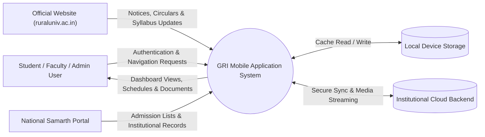
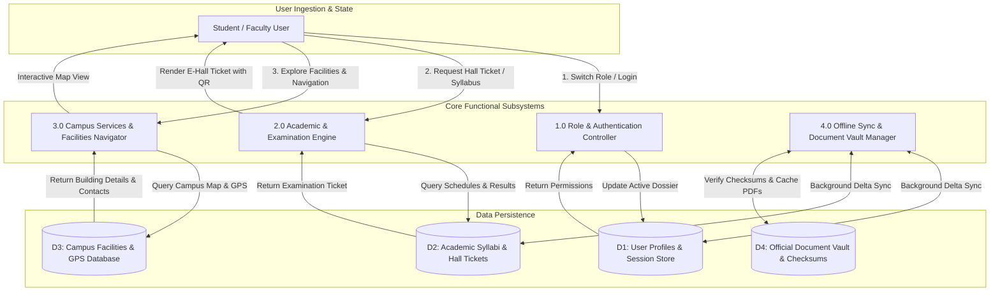

# Phase H — Data Flow Architecture (DFD Levels 0 & 1)

## 1. DFD Level 0 — Context-Level Data Flow

The Context Diagram defines the interaction boundaries between external entities and the Gandhigram Rural Institute (GRI) Mobile Application System:

---

## 2. DFD Level 1 — Detailed System Decomposition

The Level 1 diagram breaks down the GRI Mobile App into its four primary processing engines:

---

## 3. Data Dictionary for Subsystem Exchanges

| Subsystem Process | Inbound Data Flows | Outbound Data Flows | Primary Data Store |
| :--- | :--- | :--- | :--- |
| **1.0 Auth Controller** | Role toggle, User credentials, Clarification responses | Active Role Token, Navigation Tab Permissions | `D1: User Profiles` |
| **2.0 Academic Engine** | Roll Number, Semester index, Course code query | Hall Ticket Dossier, QR Hash, Subject Syllabus | `D2: Academic Syllabi` |
| **3.0 Campus Navigator** | Facility Category filter, GPS location trigger | Coordinates (`10.2798, 77.9333`), Phone Hotlines | `D3: Campus Facilities` |
| **4.0 Sync Manager** | Local cache timestamps, Network connectivity status | Verified Document Blobs, Delta JSON Updates | `D4: Document Vault` |
