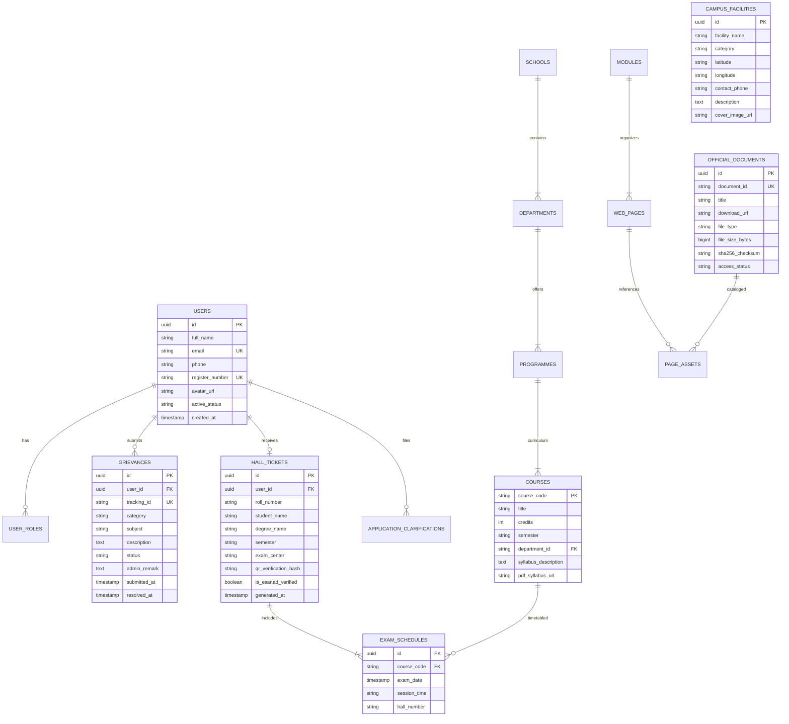

# Phase H — Entity-Relationship Diagram (ERD) & Database Schemas

> [!NOTE]
> **Schema Design Proposal**: All database schemas documented below represent the normalized relational design for the upcoming institutional cloud backend. No production databases have been altered.

---

## 1. Entity-Relationship Diagram (ERD)



---

## 2. Table Schemas & Relational Specifications

### 2.1 Table: `users`
| Column | Type | Constraints | Description |
| :--- | :--- | :--- | :--- |
| `id` | `UUID` | Primary Key, `default gen_random_uuid()` | Unique user identifier |
| `full_name` | `VARCHAR(150)` | NOT NULL | User's full name |
| `email` | `VARCHAR(255)` | UNIQUE, NOT NULL | Institutional or personal email |
| `register_number` | `VARCHAR(50)` | UNIQUE, NULLABLE | Student Roll No. or Staff ID |
| `active_role` | `VARCHAR(30)` | NOT NULL, DEFAULT 'STUDENT' | Current active role enum |
| `account_status` | `VARCHAR(30)` | NOT NULL, DEFAULT 'PENDING' | Approval state lifecycle |

### 2.2 Table: `hall_tickets`
| Column | Type | Constraints | Description |
| :--- | :--- | :--- | :--- |
| `id` | `UUID` | Primary Key | Unique hall ticket voucher ID |
| `user_id` | `UUID` | Foreign Key -> `users(id)` | Recipient student |
| `roll_number` | `VARCHAR(50)` | NOT NULL | Roll number (e.g. `2024-MS-4011`) |
| `exam_center` | `VARCHAR(150)` | NOT NULL | Assigned examination hall |
| `qr_verification_hash`| `TEXT` | NOT NULL | Cryptographic SHA-256 validation token |
| `is_esanad_verified` | `BOOLEAN` | DEFAULT TRUE | External MEA e-SANAD attestation flag |

### 2.3 Table: `official_documents`
| Column | Type | Constraints | Description |
| :--- | :--- | :--- | :--- |
| `id` | `UUID` | Primary Key | Internal document identifier |
| `document_id` | `VARCHAR(50)` | UNIQUE | Catalog ID (e.g. `AST-DOC-0001`) |
| `title` | `VARCHAR(255)` | NOT NULL | Descriptive document name |
| `download_url` | `TEXT` | NOT NULL | Official source link on `ruraluniv.ac.in` |
| `sha256_checksum` | `VARCHAR(64)` | NULLABLE | SHA-256 hash for local offline verification |
| `access_status` | `VARCHAR(40)` | NOT NULL | `PUBLIC_VERIFIED`, `RESTRICTED_LAN`, etc. |


---

## 4. Institutional Portals & E-Governance Data Models

```sql
-- Table: Portal Gateway Registry
CREATE TABLE portal_gateways (
    id UUID PRIMARY KEY DEFAULT gen_random_uuid(),
    portal_key VARCHAR(50) UNIQUE NOT NULL, -- e.g., 'hostel', 'griims', 'etrack', 'lms', 'attendance'
    display_name VARCHAR(150) NOT NULL,
    endpoint_url TEXT NOT NULL,
    auth_strategy VARCHAR(50) NOT NULL, -- 'SSO_COOKIE', 'JWT_BEARER', 'EXTERNAL_REDIRECT'
    target_persona VARCHAR(50) NOT NULL, -- 'STUDENT', 'SCHOLAR', 'FACULTY', 'ADMIN'
    is_active BOOLEAN DEFAULT true,
    created_at TIMESTAMPTZ DEFAULT NOW()
);

-- Table: User Secure Portal Sessions
CREATE TABLE user_portal_sessions (
    id UUID PRIMARY KEY DEFAULT gen_random_uuid(),
    user_id UUID REFERENCES users(id) ON DELETE CASCADE,
    portal_id UUID REFERENCES portal_gateways(id) ON DELETE CASCADE,
    session_token TEXT NOT NULL,
    refresh_token TEXT,
    expires_at TIMESTAMPTZ NOT NULL,
    created_at TIMESTAMPTZ DEFAULT NOW()
);

-- Table: G-Track Digital File Tracking Dockets
CREATE TABLE etrack_dockets (
    id UUID PRIMARY KEY DEFAULT gen_random_uuid(),
    docket_number VARCHAR(100) UNIQUE NOT NULL,
    subject TEXT NOT NULL,
    origin_department VARCHAR(150) NOT NULL,
    current_location VARCHAR(150) NOT NULL,
    current_officer VARCHAR(150),
    status VARCHAR(50) NOT NULL, -- 'DISPATCHED', 'IN_TRANSIT', 'RECEIVED', 'CLOSED'
    movement_history JSONB NOT NULL DEFAULT '[]'::jsonb,
    updated_at TIMESTAMPTZ DEFAULT NOW()
);
```
