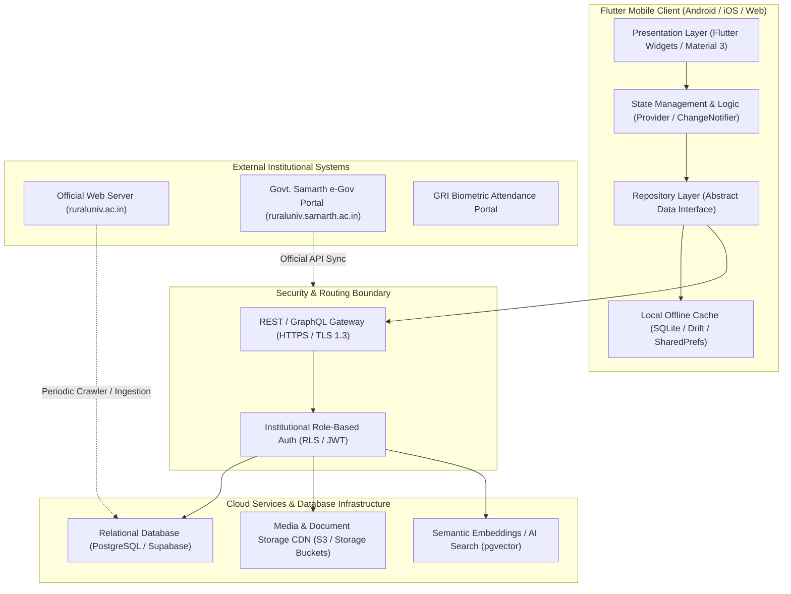

# Phase H — Proposed High-Level System Architecture

> [!NOTE]
> **Planning Proposal Only**: In accordance with the non-negotiable rules, this architectural specification is a design proposal. No backend services have been registered, modified, or provisioned during this discovery phase.

---

## 1. High-Level Architectural Topology

---

## 2. Layered Mobile Architecture (MVVM / Repository Pattern)

### 2.1 Presentation Layer (`lib/screens/` & `lib/widgets/`)
- Pure Flutter UI widgets adhering to Material 3 design tokens.
- Stateless and stateful views observing providers via `context.watch<T>()` or `Consumer<T>`.
- Responsive layout breakpoints ensuring 0px overflow across phone screens (e.g. 1080x2340 FHD+), tablets, and foldables.
- Complete dark mode parity using predefined palette tokens (`GriColors.forestPrimary`, `GriColors.darkSurface1`, `GriColors.darkSurface2`).

### 2.2 Domain & Business Logic Layer (`lib/providers/` & `lib/models/`)
- Encapsulates institutional business rules:
  - Role-based view filtering (`STUDENT`, `FACULTY`, `ADMIN`, `COE_STAFF`, `SCHOLAR`, `GUEST`).
  - Admission status verification lifecycle (`PENDING_APPROVAL`, `UNDER_REVIEW`, `APPROVED`).
  - Grievance submission and status resolution workflow.
  - Examination hall-ticket generation and QR checksum verification.

### 2.3 Data Layer & Repository Pattern (`lib/repositories/` & `lib/services/`)
- Provides a clean abstraction between the UI and data sources.
- **Offline-First Strategy**: All read requests first query local SQLite/Drift cache.
- Background synchronization fetches delta updates via HTTP/REST from the remote server when network connectivity is established.

---

## 3. Security, Privacy & Network Boundaries
1. **Zero Secret Exposure**: No database service-role keys or administrator tokens bundled within client APK binaries.
2. **Row-Level Security (RLS)**: Enforced at the database engine level so students can only access their own dossier and hall ticket data.
3. **Institutional Media Integrity**: Official documents (PDFs) are validated against SHA-256 checksums to guarantee tamper-proof academic records.
