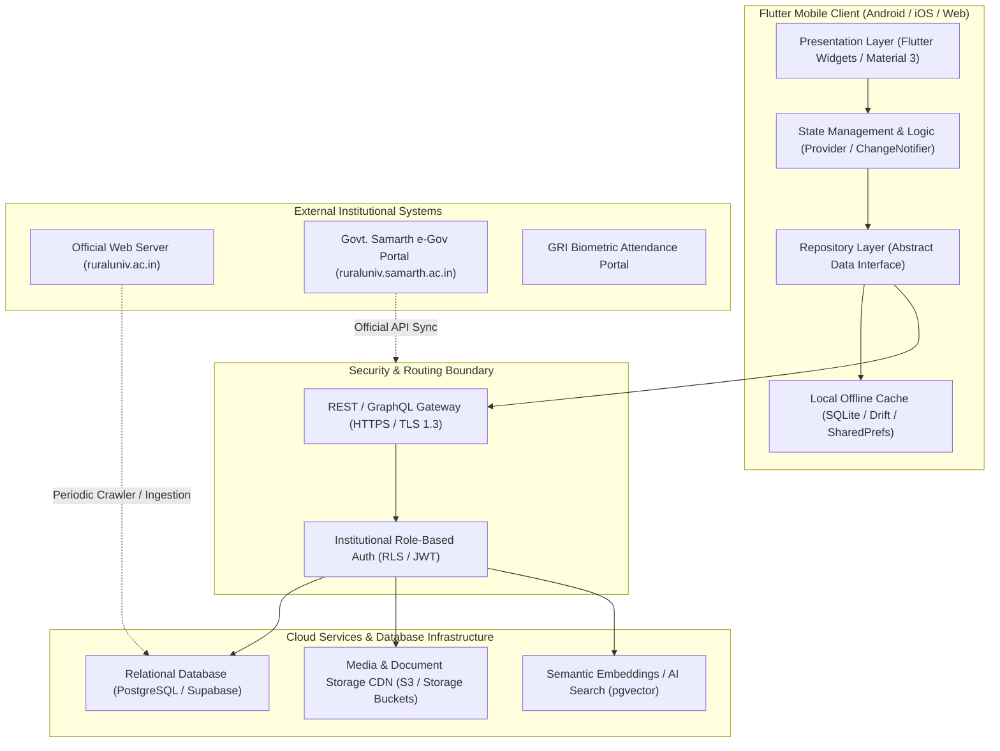

# Phase H — Proposed High-Level System Architecture

> [!NOTE]
> **Planning Proposal Only**: In accordance with the non-negotiable rules, this architectural specification is a design proposal. No backend services have been registered, modified, or provisioned during this discovery phase.

---

## 1. High-Level Architectural Topology

---

## 2. Layered Mobile Architecture (MVVM / Repository Pattern)

### 2.1 Presentation Layer (`lib/screens/` & `lib/widgets/`)
- Pure Flutter UI widgets adhering to Material 3 design tokens.
- Stateless and stateful views observing providers via `context.watch<T>()` or `Consumer<T>`.
- Responsive layout breakpoints ensuring 0px overflow across phone screens (e.g. 1080x2340 FHD+), tablets, and foldables.
- Complete dark mode parity using predefined palette tokens (`GriColors.forestPrimary`, `GriColors.darkSurface1`, `GriColors.darkSurface2`).

### 2.2 Domain & Business Logic Layer (`lib/providers/` & `lib/models/`)
- Encapsulates institutional business rules:
  - Role-based view filtering (`STUDENT`, `FACULTY`, `ADMIN`, `COE_STAFF`, `SCHOLAR`, `GUEST`).
  - Admission status verification lifecycle (`PENDING_APPROVAL`, `UNDER_REVIEW`, `APPROVED`).
  - Grievance submission and status resolution workflow.
  - Examination hall-ticket generation and QR checksum verification.

### 2.3 Data Layer & Repository Pattern (`lib/repositories/` & `lib/services/`)
- Provides a clean abstraction between the UI and data sources.
- **Offline-First Strategy**: All read requests first query local SQLite/Drift cache.
- Background synchronization fetches delta updates via HTTP/REST from the remote server when network connectivity is established.

---

## 3. Security, Privacy & Network Boundaries
1. **Zero Secret Exposure**: No database service-role keys or administrator tokens bundled within client APK binaries.
2. **Row-Level Security (RLS)**: Enforced at the database engine level so students can only access their own dossier and hall ticket data.
3. **Institutional Media Integrity**: Official documents (PDFs) are validated against SHA-256 checksums to guarantee tamper-proof academic records.

---

## 4. Institutional Portals & E-Governance Integration Subsystem

GRI operates multiple mission-critical web portals accessible through the centralized **GRI Web Portal Hub** (`https://ruraluniv.ac.in/Portal/index.html`). The mobile architecture provides a unified gateway integrating these specialized subsystems:

### 4.1 Cataloged Institutional Portals & Role Mapping

| Portal Subsystem | Endpoint URL | Target User Persona | Primary Functionality | Mobile Integration Strategy |
| :--- | :--- | :--- | :--- | :--- |
| **GRI Portal Hub** | `https://ruraluniv.ac.in/Portal/index.html` | All Users & Visitors | Central launchpad for all university e-services | Native Flutter Hub + Deep-link router |
| **Student Portal** | `https://portal.ruraluniv.ac.in/` | Enrolled Students | Grades, semester registrations, fees, CIA scores | OAuth2/JWT SSO + Cached Native Dossier |
| **Research Scholar Portal** | `https://portal.ruraluniv.ac.in/scholar` | Ph.D. & Post-Docs | Progress reports, RAC reviews, coursework credits | Authenticated WebView with Secure Cookie Store |
| **Hostel Management Portal**| `https://ruraluniv.ac.in/grihostel/login` | Resident Students / Wardens | Room allotment, mess billing, gate-pass tracking | Native Hostel Module + WebView fallback |
| **LMS Portal** | `https://portal.ruraluniv.ac.in/lms` | Students & Faculty | Course content, assignments, lecture notes | Native File Downloader + Modular LMS Reader |
| **Attendance Portal** | `https://attendance.ruraluniv.ac.in/` | Faculty & HODs | Daily biometrics, hourly attendance posting | Biometric Bridge + REST API Synchronization |
| **Pensioner Portal** | `https://pension.ruraluniv.ac.in/` | Retired Staff | Pension slip generation, life certificate status | Secure Session WebView with Document Print API |
| **G-Track (E-Track)** | `https://portal.ruraluniv.ac.in/etrack` | Administrative Staff | Digital file dispatch, movement tracking, docket history | Native Barcode/QR Scanner + File Status Timeline |
| **Department Portal** | `https://portal.ruraluniv.ac.in/Department` | Deans, HODs, Faculty | Departmental inventories, workload allocations | Role-Protected Administrative Terminal |
| **Ph.D. Evaluation** | `https://ruraluniv.ac.in/phd_evaluation/`| External Thesis Examiners | Online thesis review, viva reports, examiner marks | Encrypted Session Tunnel with PDF Annotation Support |
| **GRIIMS Ph.D. Tracking** | `https://ruraluniv.ac.in/GRIIMS1` | Research Supervisors | Candidate tracking, synopsis submission milestone | REST API / Secured Micro-frontend Gateway |
| **Downloads Portal** | `https://ruraluniv.ac.in/gridu?content=downloads` | Public / Students | Official forms, certificate templates, circulars | Native Document Center with Offline Caching |

### 4.2 Architectural Design Patterns for Portal Integration
1. **Hybrid Secure Session Bridge**: For complex authenticated web modules (e.g. Pensioner, Ph.D. Evaluation), Flutter encapsulates standard WebViews (`webview_flutter`) with custom cookie injection and SSL certificate pinning.
2. **Deep-Linking & In-App Routing**: Clicking any portal link automatically detects whether the target user is authenticated, routing directly to the corresponding native screen or launching an authenticated session with seamless return navigation.
3. **Graceful Offline Degradation**: When network connectivity is intermittent, the mobile application serves cached profile snapshots, recent circulars, and downloaded documents while queuing outbound form submissions in the local SQLite sync queue.

