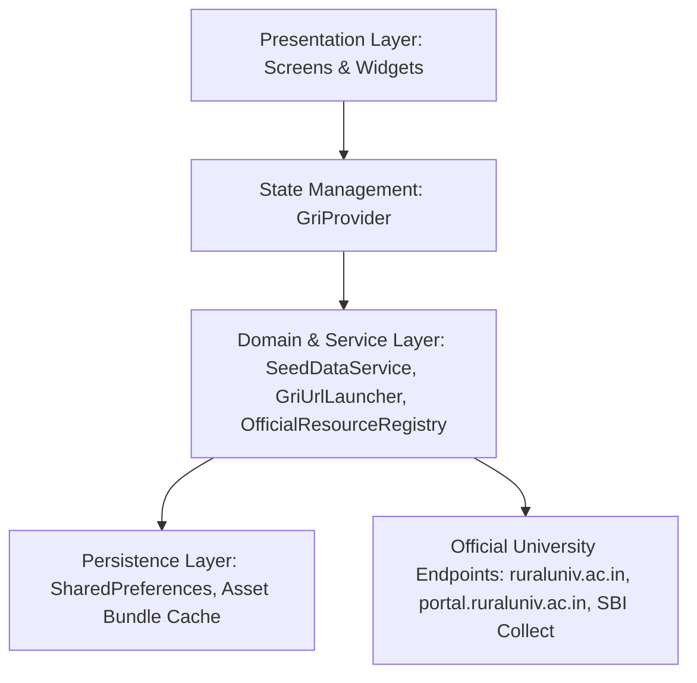

# GRI Complete End-to-End System Architecture

## 1. Executive Summary & Architecture Standard
The Gandhigram Rural Institute (Deemed to be University) Mobile Application (`gri-updated`, package `com.aistudio.grist.kxmpzq`) is engineered in Flutter 3.47.7 / Dart 3.7.0 targeting modern Android devices (Android 11 through Android 15, API level 30–35+).

The architectural design adheres strictly to **Clean Architecture** principles combined with **Feature-Driven Development (FDD)**, isolating UI presentation from business logic, official university data synchronization, and device-level hardware/intent abstractions.

---

## 2. Layered Architecture Overview

### 2.1 Presentation Layer (`lib/screens/`, `lib/widgets/`)
- **Theme & Design System**: Gandhian heritage palette defined in `lib/utils/gri_colors.dart` (Khadi Ivory `#FAF8F5`, Forest Green `#1B4332`, Deep Ochre `#B07D1E`, Terracotta `#A34828`, Deep Teal `#006666`).
- **Typography & Accessibility**: Meets WCAG 2.2 AA contrast minimums (4.5:1 text, 3:0 graphical icons) across both Light and Dark modes.
- **Motion & Ergonomics**: Fluid spring animations and staggered entrances in `lib/utils/gri_motion.dart` honoring system reduced-motion flags.

### 2.2 Domain & State Layer (`lib/providers/`, `lib/models/`)
- **State Provider**: `GriProvider` manages user session roles (Student, Faculty, Admin, Visitor), active tab navigation, live circular feeds, and query caching.
- **Immutable Domain Entities**: Data models (`UserModel`, `AcademicModels`, `CourseModel`) encapsulate semester marks, attendance, and official prospectus data.

### 2.3 Service & Resilience Layer (`lib/services/`, `lib/utils/`)
- **`GriUrlLauncher`**: Resilient URL launcher overcoming Android 11+ `<queries>` package visibility limitations with three-tier cascading:
  1. `LaunchMode.externalApplication` (Chrome, Samsung Internet, Edge, system dialer, default mail)
  2. `LaunchMode.platformDefault`
  3. `LaunchMode.inAppBrowserView`
- **`OfficialResourceRegistry`**: Centralized registry of 100+ official downloadable PDFs, syllabi, and verified high-res campus media assets with fallback UI builders.
- **`SeedDataService`**: Pre-bundled offline dataset loaded from `assets/data/gri_official_seed.json` providing complete offline functionality.

---

## 3. High-Security Ecosystem Integration
1. **Public Information**: Full native representation of all university departments, schools, centres, and campus facilities.
2. **Authenticated Student/Faculty Portal**: Direct launch into official protected portals (`https://portal.ruraluniv.ac.in/`) preserving university security perimeter.
3. **E-Governance & National Infrastructure**: First-class gateway to COE Tatkal Examination Services, MEA e-SANAD attestation, Samarth eGov, and National Digital Library (NDLI).
4. **Institutional Fee Payment**: Safe multi-mode architecture with direct official bank counters and sandbox simulation receipt generator.
