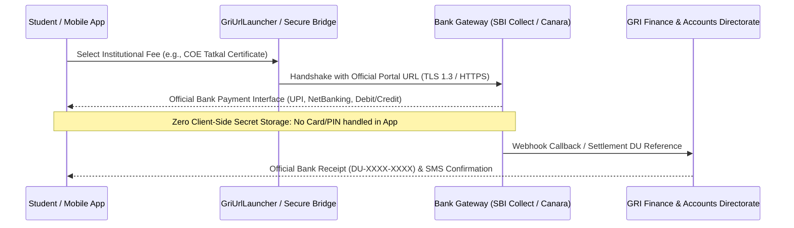

# GRI Institutional Fee Payment & Financial Services Specification

## 1. Executive Summary
The Gandhigram Rural Institute (Deemed to be University) processes academic fees, admission application charges, hostel maintenance, and examination certificate fees through official bank collection platforms, primarily **State Bank of India (SBI Collect)**, **Canara Bank E-Fee Gateway**, and designated treasury counters.

This specification documents the institutional fee architecture, security controls, gateway bridge, and the offline/sandbox test mode implemented in the mobile ecosystem.

---

## 2. Fee Categories & Official Purpose

| Fee Category Code | Purpose & Beneficiary | Official Payment Counter / Mode | Receipt Verification |
|---|---|---|---|
| `FEE_ADMISSION_PG_UG` | Admission application fee for CUET-UG & Non-CUET programmes | GRI Online Portal / SBI Collect | Immediate Registration ID & DU Ref |
| `FEE_SEMESTER_TUITION` | Semester academic & lab maintenance fee | SBI Collect / Canara Bank Portal | Semester Hall Ticket generation |
| `FEE_HOSTEL_MESS` | Kasturba & Tagore Hostels lodging & steam mess deposit | GRI Hostels Bank Account / SBI Collect | Mess Token & Room Allotment Slip |
| `FEE_COE_TATKAL_TRANS` | Controller of Examinations Tatkal Certificate / Transcripts | COE Special Fee Counter / SBI Collect | Tatkal Dispatch Tracking Number |
| `FEE_ESANAD_APOSTILLE` | Ministry of External Affairs e-SANAD Attestation | e-SANAD Non-Tax Receipt Portal (NTRP) | Ministry Verification QR Code |

---

## 3. Security & Compliance Architecture

### Key Security Standards Enforced:
1. **Zero Client Secret Storage**: The mobile app NEVER stores or handles credit card numbers, CVV, UPI PINs, or net banking passwords.
2. **Official Platform Handshake**: All genuine transactions occur directly on the bank's RBI-regulated PCI-DSS Level 1 gateway.
3. **Sandbox Test Mode**: An offline sandbox payment simulation is provided for demonstration, testing, and UI preview without executing live financial debit or mocking fake bank approvals.
4. **Idempotency & Re-entry**: Double submission prevention with unique client request identifiers (`TXN-GRI-XXXXXX`).
